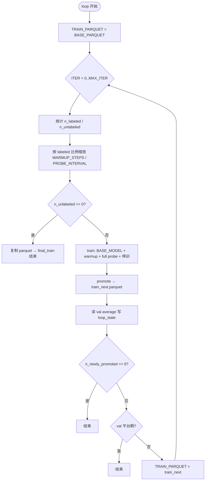

# TraPO v2：半监督迭代流水线

> 英文版：[trapo_v2_readme.md](trapo_v2_readme.md)

TraPO v2（`wsl_algorithm=trapo_v2`）在 **GRPO** 框架下做半监督学习：在 **金标样本** 上热身训练，训练过程中对 **未标注样本** 做 **probe rollout** 收集 passrate 轨迹，再 **离线 promote** 高置信伪标并迭代扩大 labeled 集合。推荐入口：`Weakly_Supervised/scripts/trapo_v2.sh`。

| 模块 | 路径 |
|------|------|
| Trainer | `Research/Semi_RL/ray_trainer_trapo_v2.py` → `RayPPOTrainerTraPOv2` |
| 启动脚本 | `scripts/trapo_v2.sh` + `scripts/trapo_v2_lib.sh` |
| 离线 promote | `utils/analysis/build_stage2_dataset.py`、`stage2_selection.py` |
| 路径解析 | `scripts/dept_root.sh` |

---

## 1. 目的与设计

### 1.1 要解决的问题

半监督场景里通常同时存在：

- **金标（labeled）**：`extra_info.labeled=true`，`reward_model.ground_truth` 可信，用于 reward 与 probe 对照。
- **未标注（unlabeled）**：`labeled=false`；模型 rollout + 多数票得到伪标签，再决定是否纳入训练。

TraPO v2 的目标：

1. **warmup 阶段** 只用金标更新策略，并周期性 **probe** 全表（或 batch），把每条样本的多数票答案与 passrate 轨迹写入磁盘。
2. **warmup 结束后停止当轮训练**（迭代模式默认），按 passrate + slope 规则 **离线 promote** 达标未标注样本。
3. **每轮从 `BASE_MODEL` 重新初始化**（不串联上一轮 ckpt），在扩大后的 parquet 上重复，直到无新 promote、验证平台期或 `MAX_ITER`。
4. **（可选）** 在 `final_train.parquet` 上做 **Phase 2 长训**，得到可部署 checkpoint。

### 1.2 TraPO v1（`trapo`）与 TraPO v2 对比

| 维度 | TraPO v1 | TraPO v2 |
|------|----------|----------|
| 训练形态 | 单次长跑；warmup 后继续 GRPO + 在线 cosine 筛未标注 | 默认 **warmup 后停训**；promote **离线** |
| 数据集 | 固定 parquet | **迭代** `train_next.parquet`；未升格样本留在池中 |
| 每轮权重 | 同一 run 内延续 | **每 iter 从 `BASE_MODEL` 重来**（`resume_mode=disable`） |
| Probe 落盘 | 较弱 / 非迭代主线 | **`all_probes_summary.jsonl`** 驱动 promote |
| Promote | 训练步内在线 `topk` / `thres` | 离线 **`PASSRATE_MIN` + `SLOPE_MIN`**（current majority） |

### 1.3 两种运行模式（同一 Trainer，不同开关）

| 模式 | `trapo_stop_after_warmup` | warmup 之后 |
|------|---------------------------|-------------|
| **迭代流水线（推荐）** | `True`（`trapo_v2.sh train` 默认） | 停训 → shell `promote` → 下一轮 |
| **单 run 长训（类 v1）** | `False` | 继续 GRPO；在线 `_compute_trajectory_cosine`（`topk` / `thres`） |

下文 **pipeline / loop / train** 指第一种；`probe` 子命令只做一轮 warmup+probe，不进入 iter 目录循环。

---

## 2. 训练数据如何构造

### 2.1 Parquet 行格式（与 verl RLHF 一致）

每一行是一条可训练样本，至少包含：

| 字段 | 说明 |
|------|------|
| `prompt` / `raw_prompt` | 模型输入（chat 或纯文本，与数据集类一致） |
| `reward_model.ground_truth` | 金标答案；未标注行可用占位 GT，promote 后会被覆盖 |
| `extra_info` | **必须**含 `labeled`（bool）与稳定 **`index`**（int，全表唯一） |
| `data_source` | 可选；验证日志按源聚合 |

**`extra_info` 示例（金标）：**

```json
{
  "index": 42,
  "labeled": true
}
```

**`extra_info` 示例（未标注）：**

```json
{
  "index": 1003,
  "labeled": false
}
```

运行时划分：`utils/data_utils.py` → `get_labeled_unlabeled_indices()`，依据 `extra_info.labeled`（兼容 `sample_type` 字符串）。

### 2.2 示例数据路径

| 文件 | 用途 |
|------|------|
| `data/example/semi-supervised-zero-fixed.parquet` | `trapo_v2_lib.sh` 默认 `BASE_PARQUET` |
| `data/example/semi-supervised-tiny-fixed.parquet` | 小规模调试 |
| `data/example/valid.parquet` | 验证（集群可改为如 `data/deepmath-hard/valid.parquet`） |

### 2.3 Promote 后新增字段

对 **新升格** 的未标注行，`build_stage2_dataset.advance_training_parquet` 会写入：

| 位置 | 字段 | 含义 |
|------|------|------|
| `extra_info` | `labeled=true` | 此后按金标路径处理 |
| `extra_info` | `promoted_from_unlabeled=true` | 升格来源标记 |
| `extra_info` | `promotion_iteration` | 第几轮 iter promote |
| `extra_info` | `pseudo_final_passrate`, `pseudo_slope`, … | 当选答案的 probe 统计 |
| `reward_model` | `ground_truth` | 改为 probe **current majority**（`pseudo_gt`） |
| `reward_model` | `original_gt` | 升格前 GT 备份 |

**迭代 parquet 组成（`keep_remaining_unlabeled=True`）：**

```text
原始金标（labeled）
+ 历史已 promote 的 labeled
+ 本轮新 promote 的 labeled
+ 仍未达标的 unlabeled（继续留在池中）
```

行数一般 **不变**（只改标签与 metadata，不删未达标样本）。

### 2.4 实践建议

1. **`index` 稳定**：跨 iter 使用同一逻辑 ID（不要用行号，除非从头重建且不再变序）。
2. **金标质量**：warmup 与 `real_passrate` 依赖金标 reward；金标噪声会反映在 probe 对照里。
3. **未标注池规模**：池子越大，每轮 `trapo_probe_scope=full` 的 probe 成本越高（整表多轮 rollout）。
4. **首轮数据**：`BASE_PARQUET`；后续轮自动使用 `iter_{k-1}/train_next.parquet`。

---

## 3. 端到端流程（脚本层）

### 3.1 命令与子命令

```bash
# 在仓库根目录（能执行 python3 -m Weakly_Supervised.wsl_main）
bash Weakly_Supervised/scripts/trapo_v2.sh pipeline   # Phase1 loop + 可选 Phase2 final
bash Weakly_Supervised/scripts/trapo_v2.sh loop         # 仅迭代
bash Weakly_Supervised/scripts/trapo_v2.sh train      # 单轮 iter（需 ITER、TRAIN_PARQUET）
bash Weakly_Supervised/scripts/trapo_v2.sh promote      # 仅离线 promote
bash Weakly_Supervised/scripts/trapo_v2.sh probe        # 单次 warmup+probe（无 iter 目录树）
bash Weakly_Supervised/scripts/trapo_v2.sh final        # 在 final_train.parquet 上长训
bash Weakly_Supervised/scripts/trapo_v2.sh help
```

Hydra 覆盖写在命令末尾，例如：

```bash
TRAPO_WARMUP_STEPS=32 bash Weakly_Supervised/scripts/trapo_v2.sh train
```

### 3.2 Phase 1：迭代 loop（`trapo_v2_cmd_loop`）



**重要行为：**

- **不读取** `loop_state.json` 续跑；每次 `loop` 从 `BASE_PARQUET`、`ITER=0` 开始。
- 每轮 train 前 `unset CKPT_DIR`；ckpt 写入 `ITER_ROOT/iter_k/ckpt`（避免 iter 串目录）。
- `trainer.resume_mode=disable`：每轮在 **global step 0** 加载 `BASE_MODEL`。

### 3.3 Phase 2：final 长训（可选）

`RUN_FINAL_LONG_TRAIN=1`（pipeline 默认）时：

- 数据：`ITER_ROOT/final_train.parquet`
- 权重：`INIT_MODEL=BASE_MODEL`（仍非 iter ckpt）
- `trapo_stop_after_warmup=False`，`trapo_probe_interval=0`，正常多 epoch GRPO

### 3.4 `loop` 与 `pipeline` 默认差异

| 变量 | 仅 `loop`（`trapo_v2_lib.sh`） | `pipeline` 覆盖 |
|------|-------------------------------|-----------------|
| `PASSRATE_MIN` | 0.5 | **0.6** |
| `MAX_ITER` | 20 | **10** |
| `VAL_PATIENCE` | 2 | 2 |
| `FINAL_EPOCHS` | — | **3** |

---

## 4. 单轮训练内部实现（`RayPPOTrainerTraPOv2`）

### 4.1 每个 `global_step`（从 1 递增）

```text
1. （可选）trapo_probe：额外 rollout，积累 probe buffer / 写 JSONL
2. 正常 rollout：每个 prompt n 个 response（actor_rollout_ref.rollout.n）
3. _apply_pseudo_labels_for_training：多数票 → majority_passrate 等
4. 若 warmup 已完成且未 stop_after_warmup：对未标注做 _compute_trajectory_cosine
5. GRPO：reward → advantage → update_actor
```

迭代模式下，**最后一个 warmup 步** 且 `stop_after_warmup=True` 时，第 4 步变为 `_split_labeled_samples`（仅金标 + 已 promote）；**不再**在线 cosine 扩池，扩池由离线 promote 完成。

### 4.2 Warmup（`trapo_warmup_labeled_only_train`）

| 配置项 | 默认（iter train） | 作用 |
|--------|-------------------|------|
| `trapo_warmup_labeled_only_train` | `True` | 启用 **仅金标** 子 DataLoader |
| `trapo_warmup_labeled_prompts_per_step` | 128（trainer 默认） | 每步从金标池采样的 prompt 数 |
| `trapo_probe_warmup_steps` | 20（代码）；脚本常 5–32 | 至少多少 **global step** |
| `trapo_probe_warmup_min_probes` | 0（代码）/ 2（iter 脚本） | 至少完成几轮 **probe round** |

**Warmup 完成条件（同时满足）：**

```text
global_steps >= trapo_probe_warmup_steps
AND trapo_probe_count >= trapo_probe_warmup_min_probes
```

Warmup 期间仍会对 unlabeled 做 probe，但 **GRPO 更新主要来自 labeled 子集**，避免未标注 rollout 被筛掉后浪费算力。

### 4.3 Probe（`trapo_probe_*`）

| 配置项 | iter train 默认 | 含义 |
|--------|-----------------|------|
| `trapo_probe_only_during_warmup` | `True` | warmup 完成后不再 probe |
| `trapo_probe_interval` | `1`（脚本） | 每 N 个 global step probe 一次；`0` 关闭 |
| `trapo_probe_scope` | **`full`**（脚本） | 每轮 probe **整表**；`batch` 仅当前训练 batch |
| `trapo_probe_save_artifacts` | `True` | 写入 `probe_dumps/` |
| `trapo_probe_dump_subdir` | `probe_dumps` | 相对 `log_dir` |

**单次 probe round（`scope=full`）流程：**

1. 独立 `StatefulDataLoader`（顺序遍历 `train_dataset`，不消耗主训练 iterator）。
2. 每个 batch：`_trapo_rollout_batch` → `_trapo_process_rollout(append_buffers=True)`。
3. 按 `index` 合并 summary，追加到 `all_probes_summary.jsonl`。
4. `trapo_probe_count += 1`。

**内存 buffer（与 v1 类似）：**

| 字典 | 内容 |
|------|------|
| `label_passrate_list[index]` | 金标行上对 GT 的 passrate 轨迹 |
| `unlabel_passrate_list[index]` | 未标注行上对 **当前多数票** 的 passrate 轨迹 |
| `majority_answer_list[index]` | 每轮 probe 的多数票历史（consistency） |
| `majority_answer[index]` | 当前多数票 |

### 4.4 Warmup 结束停训（迭代模式）

| 配置项 | 默认 | 作用 |
|--------|------|------|
| `trapo_stop_after_warmup` | `True`（iter） | 满足 warmup 条件后 **结束 `fit()`** |
| `trapo_save_on_warmup_stop` | `True` | 停训前保存 ckpt 到 `iter_k/ckpt` |

若配置了 `val_reward_fn` 会再打一次验证；日志提示从 probe dumps 做 promote。

### 4.5 在线轨迹筛选（`trapo_stop_after_warmup=False`）

warmup 之后对未标注 batch 使用 `_compute_trajectory_cosine`：

| 配置项 | 默认 | 作用 |
|--------|------|------|
| `topk` | 0.1 | 按 cosine 相似度保留 top 比例 |
| `thres` | 0.4 | 相似度阈值，超过则保留（与 topk **并集**） |
| `trapo_consistency_enabled` | `False`（脚本） | 是否要求 majority 历史一致性 |
| `trapo_consistency_min` | 0.5 | 一致性下限 |
| `trapo_history_len` | 6 / 8 | 历史窗口 |
| `update_db` | `True` | 是否把选中样本轨迹写入 ref DB |

相似度：未标注 passrate 轨迹 vs 金标 passrate 轨迹池的 **cosine similarity**（按步归一化）。

---

## 5. 离线 Promote（`build_stage2_dataset`）

### 5.1 输入

- 当前轮训练 parquet：`TRAIN_PARQUET`
- Probe 目录：`ITER_ROOT/iter_k/log/probe_dumps/`
  - 必需：`all_probes_summary.jsonl`
  - 若无则自动生成：分析链（如 `unlabeled_answer_analysis.json`）

### 5.2 选取规则（`stage2_selection.select_promoted_unlabeled_samples`）

对每个 **未标注** `sample_index`，在 **current majority** 答案上：

| 条件 | 默认 | 说明 |
|------|------|------|
| `final_passrate >= PASSRATE_MIN` | loop 0.5 / pipeline 0.6 | 末轮 probe 通过率下限（含） |
| `slope > SLOPE_MIN` | 0.05（严格大于） | passrate 对 probe 轮次的线性斜率 |
| `hist_len` | 8 | 构造 current majority 的历史窗口 |

斜率与 passrate 序列来自 `probe_slope_history_consistency_analysis` 对 `all_probes_summary.jsonl` 的分析。

### 5.3 命令示例

```bash
export ITER=0
export TRAIN_PARQUET=/path/to/current.parquet
export ITER_ROOT=/path/to/semi_supervised_trapo_v2_iter_loop
bash Weakly_Supervised/scripts/trapo_v2.sh promote

# 或直接调用 Python
python3 -m Weakly_Supervised.utils.analysis.build_stage2_dataset \
  "$TRAIN_PARQUET" \
  "$ITER_ROOT/iter_0/log/probe_dumps" \
  -o "$ITER_ROOT/iter_0/train_next.parquet" \
  --passrate-min 0.5 --slope-min 0.05 --promotion-iteration 0
```

---

## 6. 配置参考

### 6.1 环境变量（`trapo_v2_lib.sh`）

| 变量 | 含义 |
|------|------|
| `ROOT` / `SAVE_ROOT` | 代码根与输出根（集群路径） |
| `BASE_MODEL` | 每 iter 初始权重 |
| `BASE_PARQUET` | iter 0 训练数据 |
| `ITER_ROOT` | 迭代产物根目录 |
| `PASSRATE_MIN`, `SLOPE_MIN`, `HIST_LEN` | promote 阈值 |
| `MAX_ITER`, `VAL_PATIENCE`, `VAL_MIN_DELTA` | 循环与早停 |
| `TRAPO_WARMUP_STEPS`, `TRAPO_WARMUP_MIN_PROBES`, `TRAPO_PROBE_INTERVAL` | warmup / probe 节奏 |
| `TRAPO_SCALE_WARMUP_BY_LABELED` | `1` 时按 labeled 数量同比缩放 warmup/interval |
| `TRAPO_RESUME_CKPT` | `1` 时同 iter 崩溃可续训（默认关） |
| `RUN_FINAL_LONG_TRAIN` | pipeline 是否跑 Phase 2 |
| `TRAPO_CKPT_DIR` / `TRAPO_LOG_DIR` | 单轮路径覆盖（loop 内勿 export 脏 `CKPT_DIR`） |

### 6.2 通过 `wsl_main` 启动

```bash
python3 -m Weakly_Supervised.wsl_main \
  trainer_type=semi \
  wsl_algorithm=trapo_v2 \
  algorithm.adv_estimator=grpo \
  data.train_files=... \
  +trainer.train_mode=semi-supervised \
  ...
```

`trainer_type` 必须为 **`semi`**；算法名为 **`trapo_v2`**（见 `wsl_main.py` → `WeakTrainerInterface`）。

### 6.3 iter 训练默认 Hydra（`trapo_v2_run_train`）

| 键 | 典型值 |
|----|--------|
| `trainer.resume_mode` | `disable` |
| `trapo_stop_after_warmup` | `True` |
| `trapo_probe_only_during_warmup` | `True` |
| `trapo_probe_scope` | `full` |
| `trapo_probe_save_artifacts` | `True` |
| `trapo_warmup_labeled_only_train` | `True` |
| `+trainer.topk` / `+trainer.thres` | 0.1 / 0.4（停训模式下基本不用） |

---

## 7. 输出目录结构

设 `ITER_ROOT=$SAVE_ROOT/DE-Venus/log/$MODEL_NAME/semi_supervised_trapo_v2_iter_loop`：

```text
ITER_ROOT/
├── loop_state.json                 # 每轮记录：promote 数、val average、路径
├── final_train.parquet             # 每轮 promote 后快照（= 最新 train_next）
└── iter_k/
    ├── ckpt/
    │   └── global_step_*/          # warmup 停训 ckpt（分析用；下轮不 auto-resume）
    ├── log/
    │   ├── probe_dumps/
    │   │   ├── all_probes_summary.jsonl    # ★ promote 主输入
    │   │   ├── all_probes_rollouts.jsonl   # 可选 rollout 明细
    │   │   ├── manifest.jsonl
    │   │   └── round_00001_step_00000X/
    │   │       ├── summary.jsonl
    │   │       └── rollouts.jsonl
    │   └── valid/
    │       └── global_step_*.log           # 字段 average 用于早停
    ├── val_summary.json
    ├── train_next.parquet                  # ★ 下轮 TRAIN_PARQUET
    └── train_next.advance_meta.json        # promote 统计（n_newly_promoted 等）
```

**Phase 2 final（若开启）：**

```text
$SAVE_ROOT/DE-Venus/ckpt/$MODEL_NAME/semi_supervised_trapo_v2_final/
$SAVE_ROOT/DE-Venus/log/$MODEL_NAME/semi_supervised_trapo_v2_final/
```

**单次 `probe` 子命令（非 iter 树）：**

```text
$SAVE_ROOT/DE-Venus/log/$MODEL_NAME/semi_supervised_trapo_v2_probe_artifacts/probe_dumps/
```

### 7.1 `loop_state.json` 字段示例

| 字段 | 含义 |
|------|------|
| `iteration` | 轮次 k |
| `train_parquet_in` / `train_parquet_out` | 输入 / 输出 parquet 路径 |
| `n_unlabeled_before` | promote 前未标注数 |
| `n_newly_promoted` | 本轮新升格数 |
| `n_unlabeled_after` | 剩余未标注数 |
| `val_average` | 该轮验证平均指标 |
| `promotion_summary` | 升格子集准确率、mean passrate 等 |

---

## 8. Phase 1 早停条件

| 条件 | 说明 |
|------|------|
| `n_unlabeled == 0` | 池内无非标注；复制当前 parquet 结束 |
| `n_newly_promoted == 0` | 本轮无人升格 |
| val `average` 连续 `VAL_PATIENCE` 轮未超过 `best + VAL_MIN_DELTA` | 验证平台期 |
| `ITER == MAX_ITER` | 达到轮数上限 |

---

## 9. 分析工具（probe 之后）

| 工具 | 用途 |
|------|------|
| `utils/analysis/probe_analysis.sh` | 对 `probe_dumps` 做 passrate / slope 分析 |
| `utils/analysis/build_stage2_dataset.py` | promote / 命令行 advance |
| `utils/analysis/probe_slope_history_consistency_analysis.py` | majority 历史与 slope |
| `utils/training_utils.read_latest_val_average` | 从 `log/valid` 读 `average` |

---

## 10. 常见问题

**Q：为什么 iter1 仍从 `BASE_MODEL` 开始，而不是 iter0 的 ckpt？**  
A：设计如此：每轮只做 **probe + 扩池**，避免短 warmup 过拟合局部伪标；`iter_k/ckpt` 供分析，默认 `resume_mode=disable`。

**Q：重新跑 `loop` 会续上一次的 iter 吗？**  
A：不会。请换新 `ITER_ROOT` 或删掉旧目录；`loop` 总从 `BASE_PARQUET`、iter0 开始。

**Q：promote 后行数会变少吗？**  
A：默认 **不变**；未达标 unlabeled 仍保留。若只要金标+升格，使用 `build_stage2_dataset --drop-remaining-unlabeled`（非 pipeline 默认）。

**Q：`trapo_probe_scope=batch` 和 `full` 怎么选？**  
A：迭代脚本用 **`full`** 才能对全池未标注 promote；`batch` 更快但只覆盖当步见到的样本。

**Q：训练失败但已有 `all_probes_summary.jsonl`？**  
A：loop 在 `TRAIN_EXIT!=0` 时若 probe 文件存在仍会继续 promote（TraPO v2 shell 行为）。

---

## 11. 最小可跑示例

```bash
export ROOT=/path/to/DE-Venus
export SAVE_ROOT=/path/to/outputs
export BASE_MODEL=/path/to/Qwen3-8B-Base
export BASE_PARQUET=$ROOT/data/example/semi-supervised-tiny-fixed.parquet
export ITER_ROOT=$SAVE_ROOT/DE-Venus/log/Qwen3-8B-Base/my_trapo_v2_loop

RUN_FINAL_LONG_TRAIN=0 \
PASSRATE_MIN=0.5 \
TRAPO_WARMUP_STEPS=5 \
TRAPO_WARMUP_MIN_PROBES=2 \
bash Weakly_Supervised/scripts/trapo_v2.sh loop
```

---

## 12. 相关文档

- 总览：`Weakly_Supervised/README.md`（Semi / TraPO v2 小节）
- 英文详述：[trapo_v2_readme.md](trapo_v2_readme.md)
- TraPO v1 脚本：`scripts/semi_run_trapo.sh`
