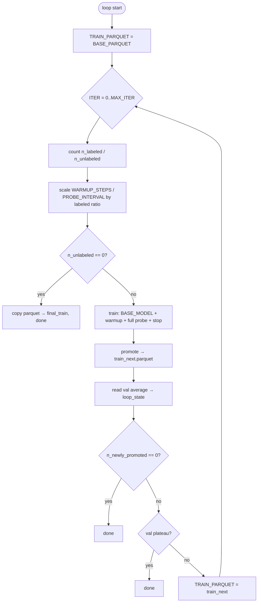

# TraPO v2: Iterative Semi-Supervised Pipeline

> Chinese: [cn_trapo_v2_readme.md](cn_trapo_v2_readme.md)

TraPO v2 (`wsl_algorithm=trapo_v2`) runs semi-supervised learning under **GRPO**: **warm up on gold-labeled data**, run **probe rollouts** on **unlabeled** samples during training to collect passrate trajectories, then **offline promote** high-confidence pseudo-labels and iterate to grow the labeled set. The recommended entry point is `Weakly_Supervised/scripts/trapo_v2.sh`.

| Component | Path |
|-----------|------|
| Trainer | `Research/Semi_RL/ray_trainer_trapo_v2.py` → `RayPPOTrainerTraPOv2` |
| Launch scripts | `scripts/trapo_v2.sh` + `scripts/trapo_v2_lib.sh` |
| Offline promote | `utils/analysis/build_stage2_dataset.py`, `stage2_selection.py` |
| Path resolution | `scripts/dept_root.sh` |

---

## 1. Goals and design

### 1.1 Problem

In semi-supervised settings you typically have:

- **Labeled (gold)**: `extra_info.labeled=true`, trustworthy `reward_model.ground_truth` for reward and probe baselines.
- **Unlabeled**: `labeled=false`; the model rollouts + majority vote produce pseudo-labels, then you decide whether to train on them.

TraPO v2 aims to:

1. **During warmup**, update the policy on labeled data only and periodically **probe** the full dataset (or batches), writing per-sample majority answers and passrate trajectories to disk.
2. **After warmup, stop that round’s training** (default in iterative mode), then **offline promote** unlabeled rows that pass passrate + slope rules (same spirit as TraPO).
3. **Re-init each iteration from `BASE_MODEL`** (do not chain the previous iter’s ckpt), repeat on the expanded parquet until there are no new promotions, validation plateaus, or `MAX_ITER`.
4. **(Optional)** run **Phase 2 long training** on `final_train.parquet` for a deployable checkpoint.

### 1.2 TraPO v1 (`trapo`) vs TraPO v2

| Aspect | TraPO v1 | TraPO v2 |
|--------|----------|----------|
| Training shape | Single long run; after warmup, GRPO + online cosine filter on unlabeled | Default: **stop after warmup**; promote **offline** |
| Dataset | Fixed parquet | **Iterative** `train_next.parquet`; un-promoted rows stay in the pool |
| Weights per round | Same run | **Each iter restarts from `BASE_MODEL`** (`resume_mode=disable`) |
| Probe artifacts | Weaker / not the iter main path | **`all_probes_summary.jsonl`** drives promote |
| Promotion | Online `topk` / `thres` in training steps | Offline **`PASSRATE_MIN` + `SLOPE_MIN`** on current majority |

### 1.3 Two operating modes (same trainer, different flags)

| Mode | `trapo_stop_after_warmup` | After warmup |
|------|---------------------------|--------------|
| **Iterative pipeline (recommended)** | `True` (`trapo_v2.sh train` default) | Stop → shell `promote` → next iter |
| **Single long run (v1-like)** | `False` | Continue GRPO; online `_compute_trajectory_cosine` (`topk` / `thres`) |

Sections below on **pipeline / loop / train** refer to the first mode. The `probe` subcommand runs one warmup+probe round only (no iter directory loop).

---

## 2. How to build training data

### 2.1 Parquet row format (verl RLHF compatible)

Each row is one trainable sample. Minimum fields:

| Field | Description |
|-------|-------------|
| `prompt` / `raw_prompt` | Model input (chat or text, per dataset class) |
| `reward_model.ground_truth` | Gold answer; unlabeled rows may use a placeholder until promote overwrites it |
| `extra_info` | **Required**: `labeled` (bool) and stable **`index`** (int, unique in the table) |
| `data_source` | Optional; validation logs aggregate by source |

**`extra_info` example (labeled):**

```json
{
  "index": 42,
  "labeled": true
}
```

**`extra_info` example (unlabeled):**

```json
{
  "index": 1003,
  "labeled": false
}
```

Runtime split: `utils/data_utils.py` → `get_labeled_unlabeled_indices()` uses `extra_info.labeled` (also supports `sample_type` strings).

### 2.2 Example data paths

| File | Use |
|------|-----|
| `data/example/semi-supervised-zero-fixed.parquet` | Default `BASE_PARQUET` in `trapo_v2_lib.sh` |
| `data/example/semi-supervised-tiny-fixed.parquet` | Small debug set |
| `data/example/valid.parquet` | Validation (cluster may use e.g. `data/deepmath-hard/valid.parquet`) |

### 2.3 Fields added after promote

For **newly promoted** unlabeled rows, `build_stage2_dataset.advance_training_parquet` writes:

| Location | Field | Meaning |
|----------|-------|---------|
| `extra_info` | `labeled=true` | Treated as gold path afterward |
| `extra_info` | `promoted_from_unlabeled=true` | Promotion marker |
| `extra_info` | `promotion_iteration` | Which iter promoted this row |
| `extra_info` | `pseudo_final_passrate`, `pseudo_slope`, … | Probe stats for the chosen answer |
| `reward_model` | `ground_truth` | Set to probe **current majority** (`pseudo_gt`) |
| `reward_model` | `original_gt` | Backup of GT before promotion |

**Iterative parquet composition (`keep_remaining_unlabeled=True`):**

```text
Original labeled (gold)
+ Previously promoted labeled
+ Newly promoted labeled this round
+ Unlabeled that did not meet thresholds (stay in the pool)
```

Row count usually **unchanged** (labels and metadata update; sub-threshold unlabeled rows are not dropped).

### 2.4 Practical tips

1. **Stable `index`**: use the same logical ID across iters (avoid row numbers unless you rebuild from scratch and never reorder).
2. **Gold quality**: warmup and `real_passrate` depend on gold reward; noisy gold hurts probe baselines.
3. **Unlabeled pool size**: larger pools cost more per round with `trapo_probe_scope=full` (full-table rollouts each probe round).
4. **First-round parquet**: `BASE_PARQUET`; later rounds use `iter_{k-1}/train_next.parquet` automatically.

---

## 3. End-to-end flow (shell layer)

### 3.1 Commands

```bash
# From repo root (must be able to run python3 -m Weakly_Supervised.wsl_main)
bash Weakly_Supervised/scripts/trapo_v2.sh pipeline   # Phase 1 loop + optional Phase 2 final
bash Weakly_Supervised/scripts/trapo_v2.sh loop         # Iteration only
bash Weakly_Supervised/scripts/trapo_v2.sh train        # Single iter (set ITER, TRAIN_PARQUET)
bash Weakly_Supervised/scripts/trapo_v2.sh promote      # Offline promote only
bash Weakly_Supervised/scripts/trapo_v2.sh probe         # One warmup+probe (no iter tree)
bash Weakly_Supervised/scripts/trapo_v2.sh final         # Long train on final_train.parquet
bash Weakly_Supervised/scripts/trapo_v2.sh help
```

Append Hydra overrides at the end, e.g.:

```bash
TRAPO_WARMUP_STEPS=32 bash Weakly_Supervised/scripts/trapo_v2.sh train
```

### 3.2 Phase 1: iteration loop (`trapo_v2_cmd_loop`)



**Important behavior:**

- **`loop_state.json` is not used to resume**; each `loop` starts from `BASE_PARQUET`, `ITER=0`.
- Before each train, `unset CKPT_DIR`; checkpoints go to `ITER_ROOT/iter_k/ckpt` (avoids cross-iter ckpt paths).
- `trainer.resume_mode=disable`: each round loads **`BASE_MODEL` at global step 0**.

### 3.3 Phase 2: final long train (optional)

When `RUN_FINAL_LONG_TRAIN=1` (pipeline default):

- Data: `ITER_ROOT/final_train.parquet`
- Weights: `INIT_MODEL=BASE_MODEL` (still not iter ckpt)
- `trapo_stop_after_warmup=False`, `trapo_probe_interval=0`, normal multi-epoch GRPO

### 3.4 Default differences: `loop` vs `pipeline`

| Variable | `loop` only (`trapo_v2_lib.sh`) | `pipeline` override |
|----------|--------------------------------|---------------------|
| `PASSRATE_MIN` | 0.5 | **0.6** |
| `MAX_ITER` | 20 | **10** |
| `VAL_PATIENCE` | 2 | 2 |
| `FINAL_EPOCHS` | — | **3** |

---

## 4. Single-round training internals (`RayPPOTrainerTraPOv2`)

### 4.1 Per `global_step` (from 1 upward)

```text
1. (Optional) trapo_probe: extra rollout; fill probe buffers / write JSONL
2. Normal rollout: n responses per prompt (actor_rollout_ref.rollout.n)
3. _apply_pseudo_labels_for_training: majority vote → majority_passrate, etc.
4. If warmup done and not stop_after_warmup: _compute_trajectory_cosine on unlabeled
5. GRPO: reward → advantage → update_actor
```

In iterative mode, step 4 on the **last warmup step** with `stop_after_warmup=True` becomes `_split_labeled_samples` (labeled + already promoted only); **no** online cosine pool expansion—offline promote handles that.

### 4.2 Warmup (`trapo_warmup_labeled_only_train`)

| Config | Default (iter train) | Role |
|--------|----------------------|------|
| `trapo_warmup_labeled_only_train` | `True` | **Labeled-only** sub-DataLoader |
| `trapo_warmup_labeled_prompts_per_step` | 128 (trainer default) | Labeled prompts sampled per step |
| `trapo_probe_warmup_steps` | 20 (code); scripts often 5–32 | Minimum **global steps** |
| `trapo_probe_warmup_min_probes` | 0 (code) / 2 (iter script) | Minimum **probe rounds** |

**Warmup complete when both hold:**

```text
global_steps >= trapo_probe_warmup_steps
AND trapo_probe_count >= trapo_probe_warmup_min_probes
```

Unlabeled rows are still probed during warmup, but **GRPO updates mainly use the labeled subset** so unlabeled rollouts are not wasted when filtered out.

### 4.3 Probe (`trapo_probe_*`)

| Config | iter train default | Meaning |
|--------|-------------------|---------|
| `trapo_probe_only_during_warmup` | `True` | No probe after warmup |
| `trapo_probe_interval` | `1` (script) | Probe every N global steps; `0` disables |
| `trapo_probe_scope` | **`full`** (script) | Each round probes **entire table**; `batch` = current train batch only |
| `trapo_probe_save_artifacts` | `True` | Write under `probe_dumps/` |
| `trapo_probe_dump_subdir` | `probe_dumps` | Relative to `log_dir` |

**One probe round (`scope=full`):**

1. Separate `StatefulDataLoader` (sequential over `train_dataset`; does not consume the main train iterator).
2. Per batch: `_trapo_rollout_batch` → `_trapo_process_rollout(append_buffers=True)`.
3. Merge summary rows by `index`, append to `all_probes_summary.jsonl`.
4. `trapo_probe_count += 1`.

**In-memory buffers (similar to v1):**

| Dict | Content |
|------|---------|
| `label_passrate_list[index]` | Passrate trajectory vs GT on labeled rows |
| `unlabel_passrate_list[index]` | Passrate vs **current majority** on unlabeled rows |
| `majority_answer_list[index]` | Majority history per probe round (consistency) |
| `majority_answer[index]` | Current majority answer |

### 4.4 Stop training after warmup (iterative mode)

| Config | Default | Role |
|--------|---------|------|
| `trapo_stop_after_warmup` | `True` (iter) | **End `fit()`** when warmup conditions met |
| `trapo_save_on_warmup_stop` | `True` | Save ckpt under `iter_k/ckpt` before exit |

Validation may run once more if `val_reward_fn` is set; logs point to promote from probe dumps.

### 4.5 Online trajectory filter (`trapo_stop_after_warmup=False`)

After warmup, unlabeled batches go through `_compute_trajectory_cosine`:

| Config | Default | Role |
|--------|---------|------|
| `topk` | 0.1 | Keep top fraction by cosine similarity |
| `thres` | 0.4 | Threshold; kept if above (**union** with topk) |
| `trapo_consistency_enabled` | `False` (script) | Require majority history consistency |
| `trapo_consistency_min` | 0.5 | Consistency floor |
| `trapo_history_len` | 6 / 8 | History window |
| `update_db` | `True` | Write selected trajectories to ref DB |

Similarity: unlabeled passrate trajectory vs pool of labeled passrate trajectories (**cosine**, step-normalized).

---

## 5. Offline promote (`build_stage2_dataset`)

### 5.1 Inputs

- Current round parquet: `TRAIN_PARQUET`
- Probe dir: `ITER_ROOT/iter_k/log/probe_dumps/`
  - Required: `all_probes_summary.jsonl`
  - Auto-generated if missing: analysis chain ending in e.g. `unlabeled_answer_analysis.json`

### 5.2 Selection (`stage2_selection.select_promoted_unlabeled_samples`)

For each **unlabeled** `sample_index`, on the **current majority** answer:

| Rule | Default | Notes |
|------|---------|-------|
| `final_passrate >= PASSRATE_MIN` | loop 0.5 / pipeline 0.6 | Last probe round passrate (inclusive) |
| `slope > SLOPE_MIN` | 0.05 (strict `>`) | Linear slope of passrate vs probe round |
| `hist_len` | 8 | Window for current majority construction |

Slopes and passrate series come from `probe_slope_history_consistency_analysis` on `all_probes_summary.jsonl`.

### 5.3 Example commands

```bash
export ITER=0
export TRAIN_PARQUET=/path/to/current.parquet
export ITER_ROOT=/path/to/semi_supervised_trapo_v2_iter_loop
bash Weakly_Supervised/scripts/trapo_v2.sh promote

# Or call Python directly
python3 -m Weakly_Supervised.utils.analysis.build_stage2_dataset \
  "$TRAIN_PARQUET" \
  "$ITER_ROOT/iter_0/log/probe_dumps" \
  -o "$ITER_ROOT/iter_0/train_next.parquet" \
  --passrate-min 0.5 --slope-min 0.05 --promotion-iteration 0
```

---

## 6. Configuration reference

### 6.1 Environment variables (`trapo_v2_lib.sh`)

| Variable | Meaning |
|----------|---------|
| `ROOT` / `SAVE_ROOT` | Code root and output root (cluster paths) |
| `BASE_MODEL` | Initial weights every iter |
| `BASE_PARQUET` | iter 0 training data |
| `ITER_ROOT` | Root for all iterative artifacts |
| `PASSRATE_MIN`, `SLOPE_MIN`, `HIST_LEN` | Promote thresholds |
| `MAX_ITER`, `VAL_PATIENCE`, `VAL_MIN_DELTA` | Loop limits and early stop |
| `TRAPO_WARMUP_STEPS`, `TRAPO_WARMUP_MIN_PROBES`, `TRAPO_PROBE_INTERVAL` | Warmup / probe schedule |
| `TRAPO_SCALE_WARMUP_BY_LABELED` | If `1`, scale warmup/interval by labeled count ratio each round |
| `TRAPO_RESUME_CKPT` | If `1`, resume crashed job in **same** iter (default off) |
| `RUN_FINAL_LONG_TRAIN` | Whether pipeline runs Phase 2 |
| `TRAPO_CKPT_DIR` / `TRAPO_LOG_DIR` | Per-round path overrides (do not leave stale `CKPT_DIR` exported in loop) |

### 6.2 Entry via `wsl_main`

```bash
python3 -m Weakly_Supervised.wsl_main \
  trainer_type=semi \
  wsl_algorithm=trapo_v2 \
  algorithm.adv_estimator=grpo \
  data.train_files=... \
  +trainer.train_mode=semi-supervised \
  ...
```

`trainer_type` must be **`semi`**; algorithm name **`trapo_v2`** (see `wsl_main.py` → `WeakTrainerInterface`).

### 6.3 Default Hydra for iter train (`trapo_v2_run_train`)

| Key | Typical value |
|-----|----------------|
| `trainer.resume_mode` | `disable` |
| `trapo_stop_after_warmup` | `True` |
| `trapo_probe_only_during_warmup` | `True` |
| `trapo_probe_scope` | `full` |
| `trapo_probe_save_artifacts` | `True` |
| `trapo_warmup_labeled_only_train` | `True` |
| `+trainer.topk` / `+trainer.thres` | 0.1 / 0.4 (unused when stop-after-warmup) |

---

## 7. Output layout

Let `ITER_ROOT=$SAVE_ROOT/DE-Venus/log/$MODEL_NAME/semi_supervised_trapo_v2_iter_loop`:

```text
ITER_ROOT/
├── loop_state.json                 # Per-round history: promote counts, val average, paths
├── final_train.parquet             # Snapshot after each promote (= latest train_next)
└── iter_k/
    ├── ckpt/
    │   └── global_step_*/          # Warmup-stop ckpt (analysis; next iter does not auto-resume)
    ├── log/
    │   ├── probe_dumps/
    │   │   ├── all_probes_summary.jsonl    # ★ main promote input
    │   │   ├── all_probes_rollouts.jsonl   # optional rollout detail
    │   │   ├── manifest.jsonl
    │   │   └── round_00001_step_00000X/
    │   │       ├── summary.jsonl
    │   │       └── rollouts.jsonl
    │   └── valid/
    │       └── global_step_*.log           # field `average` for early stop
    ├── val_summary.json
    ├── train_next.parquet                  # ★ next round TRAIN_PARQUET
    └── train_next.advance_meta.json        # promote stats (n_newly_promoted, etc.)
```

**Phase 2 final (if enabled):**

```text
$SAVE_ROOT/DE-Venus/ckpt/$MODEL_NAME/semi_supervised_trapo_v2_final/
$SAVE_ROOT/DE-Venus/log/$MODEL_NAME/semi_supervised_trapo_v2_final/
```

**Standalone `probe` subcommand (no iter tree):**

```text
$SAVE_ROOT/DE-Venus/log/$MODEL_NAME/semi_supervised_trapo_v2_probe_artifacts/probe_dumps/
```

### 7.1 `loop_state.json` record fields (example)

| Field | Meaning |
|-------|---------|
| `iteration` | Round index k |
| `train_parquet_in` / `train_parquet_out` | Input / output parquet paths |
| `n_unlabeled_before` | Unlabeled count before promote |
| `n_newly_promoted` | New promotions this round |
| `n_unlabeled_after` | Remaining unlabeled |
| `val_average` | Validation average metric for the round |
| `promotion_summary` | Accuracy on promoted subset, mean passrate, etc. |

---

## 8. Phase 1 early-stop conditions

| Condition | Description |
|-----------|-------------|
| `n_unlabeled == 0` | No unlabeled left; copy current parquet and exit |
| `n_newly_promoted == 0` | No new promotions this round |
| val `average` stalls `VAL_PATIENCE` rounds without beating `best + VAL_MIN_DELTA` | Validation plateau |
| `ITER == MAX_ITER` | Hit iteration cap |

---

## 9. Analysis tools (after probe)

| Tool | Purpose |
|------|---------|
| `utils/analysis/probe_analysis.sh` | Passrate / slope analysis on `probe_dumps` |
| `utils/analysis/build_stage2_dataset.py` | Promote / CLI advance |
| `utils/analysis/probe_slope_history_consistency_analysis.py` | Majority history and slope |
| `utils/training_utils.read_latest_val_average` | Read `average` from `log/valid` |

---

## 10. FAQ

**Q: Why does iter 1 still start from `BASE_MODEL`, not iter 0’s ckpt?**  
A: By design: each round is **probe + pool expansion**; short warmup should not overfit to local pseudo-labels. `iter_k/ckpt` is for analysis; default `resume_mode=disable`.

**Q: Does re-running `loop` continue the previous iter?**  
A: No. Use a new `ITER_ROOT` or remove the old tree; `loop` always starts from `BASE_PARQUET` at iter 0.

**Q: Does promote reduce row count?**  
A: Default **no**; sub-threshold unlabeled rows remain. To keep only gold + promoted, use `build_stage2_dataset --drop-remaining-unlabeled` (not pipeline default).

**Q: `trapo_probe_scope=batch` vs `full`?**  
A: Iter scripts use **`full`** so promote sees the whole unlabeled pool; `batch` is faster but only covers samples seen in that step.

**Q: Training failed but `all_probes_summary.jsonl` exists?**  
A: The loop still runs promote when `TRAIN_EXIT!=0` if the probe file is present (TraPO v2 shell behavior).

---

## 11. Minimal example

```bash
export ROOT=/path/to/DE-Venus
export SAVE_ROOT=/path/to/outputs
export BASE_MODEL=/path/to/Qwen3-8B-Base
export BASE_PARQUET=$ROOT/data/example/semi-supervised-tiny-fixed.parquet
export ITER_ROOT=$SAVE_ROOT/DE-Venus/log/Qwen3-8B-Base/my_trapo_v2_loop

RUN_FINAL_LONG_TRAIN=0 \
PASSRATE_MIN=0.5 \
TRAPO_WARMUP_STEPS=5 \
TRAPO_WARMUP_MIN_PROBES=2 \
bash Weakly_Supervised/scripts/trapo_v2.sh loop
```

---

## 12. Related docs

- Overview: `Weakly_Supervised/README.md` (Semi / TraPO v2 section)
- Chinese guide: [cn_trapo_v2_readme.md](cn_trapo_v2_readme.md)
- TraPO v1 script: `scripts/semi_run_trapo.sh`
